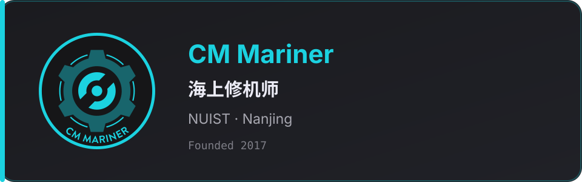

<h3 align="center">👋 Hello! I'm Potato / 土豆.</h3>

NUIST · IoT Engineering · Nanjing · Class of 2027

海上修机师 · ex-Lead · <a href="https://www.nuist.link/team/2023.html#cat-head">修机猫猫头</a>

  

  
  
  
  
  
  

Blog: <a href="https://hawaiipotato.pages.dev">Potato's Blog</a> · Email: <a href="mailto:hawaiipotatoes@gmail.com">hawaiipotatoes@gmail.com</a>

  

